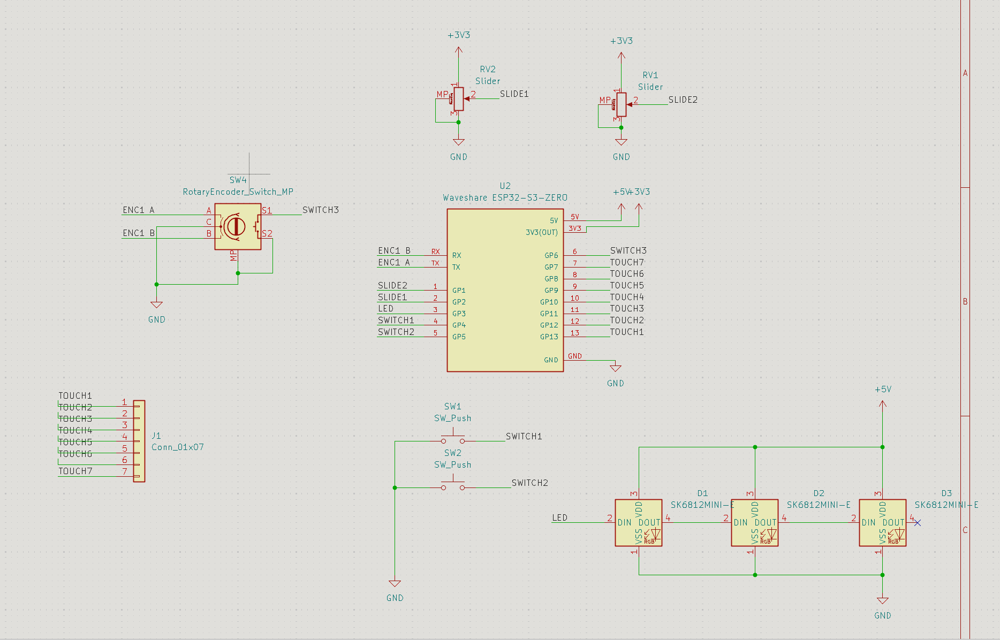
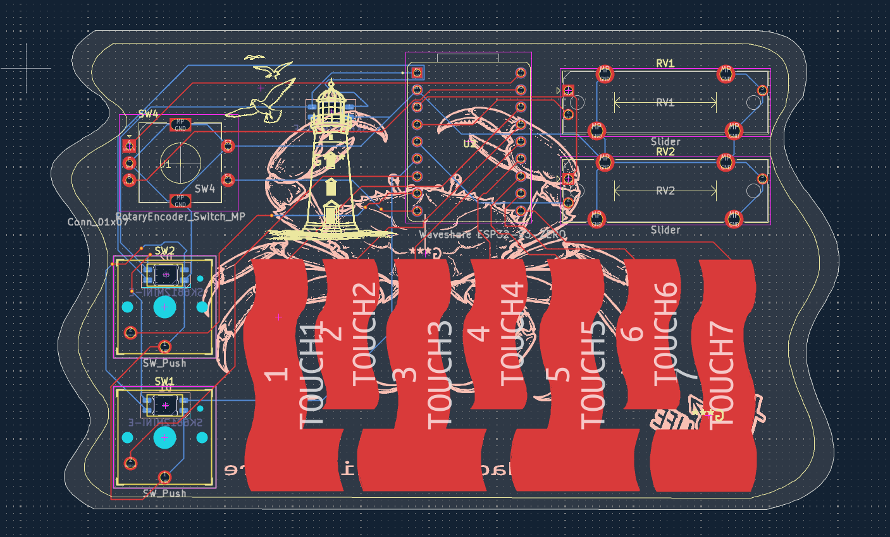

# Midi-Keyboard

## Introduction:

This is my midi keyboard that I made for the third week of the Hackclub Half Life challenge. It is ocean themed.

##Schematic:

Here is a picture of the schematics for the project. 

##PCB: 

Picture of my projects PCB. 
There are small pictures on the front and the back of the board to give the ocean vibe. 

##Picture of the front of the PCB:

##Picture of the back of the PCB:

##Firmware:

The code's main function is to react and play a sound when the user touches one of the capacitive keys (the main piano keys). 
The physical switches are here to change the octave of the notes that will be played by the capacitive keys. 

##How to flash firmware:

To flash the firmware onto the board you should follow these steps:

1. Connect the board to your computer.
2. Download CircuitPython.
3. Copy CircuitPython onto the board.
4. Save the code.py program in the board.
